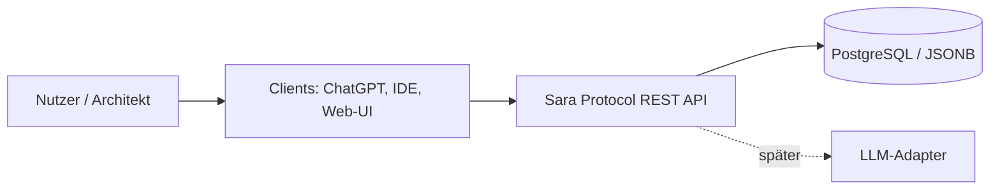
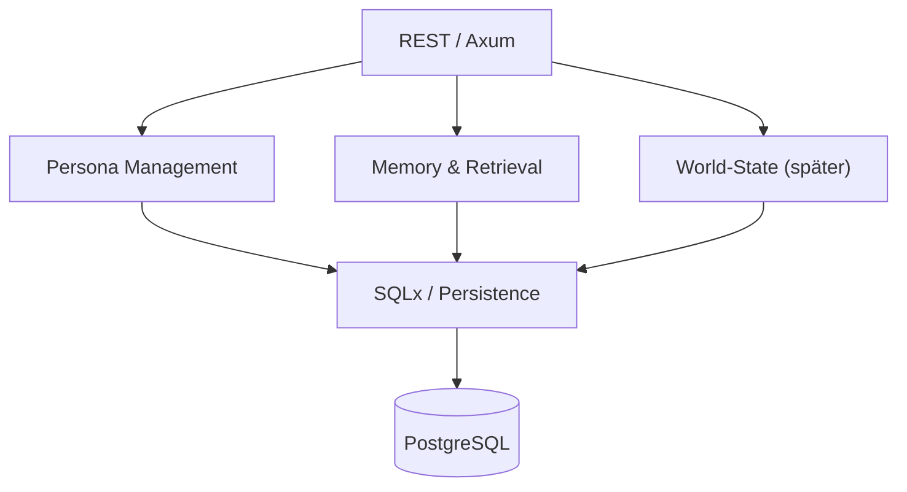

# arc42 – The Sara Protocol

> Status: Entwurf · 27.10.2026 · Dokumentationssprache: Deutsch. Code, API-Bezeichner und Commit-Nachrichten bleiben Englisch.

Diese Datei bildet das erste schlanke arc42-Grundgerüst. Bestehende Architekturentscheidungen werden verlinkt statt dupliziert. Ungeklärtes ist ausdrücklich als offen markiert.

## 1. Einführung und Ziele

Ein lokal entwickelbarer, portabler Persona-, Memory- und World-State-Dienst für mehrere KI-Charaktere. REST-API zum Persistieren, Abrufen und Suchen. Wichtige Qualitätsziele: Datenisolation, Nachvollziehbarkeit der Erinnerungsquellen, Wartbarkeit und Portabilität.

## 2. Randbedingungen

- Rust, Axum, Tokio, Serde und SQLx
- PostgreSQL mit JSONB, später optional pgvector
- macOS, Docker Compose, IntelliJ IDEA Ultimate
- Dokumentation auf Deutsch, technische Namen auf Englisch
- Entwicklung über Branches, Review und möglichst Squash-Merge

## 3. Kontextabgrenzung

Geplante Clients: ChatGPT, lokale LLMs, IDE und später eine Weboberfläche. Der Dienst stellt eine REST-API bereit; LLM-Integration ist zunächst nachgelagert.

**Systemgrenze:** Die REST-API und ihre Datenhaltung gehören zum Sara Protocol. Clients und externe bzw. lokale LLM-Laufzeiten liegen außerhalb.

## 4. Lösungsstrategie

Local-first und API-first. Personas, Memories und World-State werden getrennt modelliert. Erinnerungen erhalten Provenienz (Quelle, Zeit, bestätigter oder abgeleiteter Status). Administrative Änderungen müssen autorisiert, auditierbar und rücksetzbar sein.

## 5. Bausteinsicht

Dies ist eine **Zielarchitektur**, kein Nachweis bereits implementierter Komponenten.

## 6. Laufzeitsicht

Geplanter MVP-Ablauf: Client ruft `GET /health` auf → Axum antwortet mit Health-Status. Persona- und Memory-Endpunkte folgen danach. Authentifizierung und Fehlerfälle sind noch zu spezifizieren.

## 7. Verteilungssicht

Das Rust-Paket liegt unter `backend/`, ohne Cargo-Workspace im Root. Lokal läuft der Prozess aus diesem Verzeichnis. Alternativ baut Compose mit dem Kontext `backend/` ein Backend-Image und startet es nach gesundem PostgreSQL. Das Backend läuft als unprivilegierter Benutzer aus `/app/backend` mit mitgeliefertem `migrations/`; es erreicht PostgreSQL intern unter `postgres:5432`. Host-Ports sind auf Loopback beschränkt. Gemeinsame Konfiguration und Docs bleiben im Root. Siehe [Entwicklungs- und Deployment-Anleitung](../getting-started.md) und [ADR 0005](../adr/0005-backend-directory.md).

## 8. Querschnittliche Konzepte

- Persona-Isolation und Berechtigungen
- Memory Provenance und Versionierung
- REST, JSON, OpenAPI
- Audit-Log und Rollback administrativer Änderungen
- Tests und Migrationen
- Trennung von fiktionalem Szenenstatus und operativem Systemzustand

## 9. Architekturentscheidungen

Siehe [ADR-Index](../adr/README.md), insbesondere Rust/Axum, PostgreSQL/JSONB und die noch vorgeschlagene KI-Beitragskennzeichnung.

## 10. Qualitätsanforderungen

Nachvollziehbare Datenherkunft, sichere Trennung mehrerer Personas, reproduzierbares lokales Setup und testbare API. Konkrete Qualitäts-Szenarien und Messwerte sind noch zu definieren.

## 11. Risiken und technische Schulden

- LLM-Latenz und Retrieval-Qualität könnten wichtiger sein als die Wahl der Implementierungssprache.
- Authentifizierung, Rechtekonzept, Backup, Embeddings und Datenmodell sind noch offen.
- Die Implementierung des MVP ist noch nicht verifiziert.
- Keine unkontrollierten Persona-Änderungen oder System-Root-Rechte.

## 12. Glossar

- **Persona:** Konfigurierbare fiktionale KI-Figur mit Eigenschaften und Verhalten.
- **Memory:** Persistierte Information mit Herkunft und Status.
- **World-State:** Orte, NPCs und Szenenstatus innerhalb einer fiktionalen Welt.
- **Provenienz:** Herkunft, Zeitpunkt und Bestätigungsgrad einer Erinnerung.
- **ADR:** Architecture Decision Record, dokumentierte Architekturentscheidung.

## Weitere Unterlagen

- [Architekturentwurf](../architecture.md)
- [Roadmap](../roadmap.md)
- [Persona](../persona.md)
- [World-State](../world-state.md)
