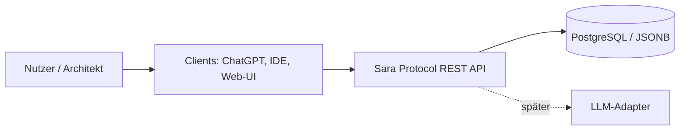
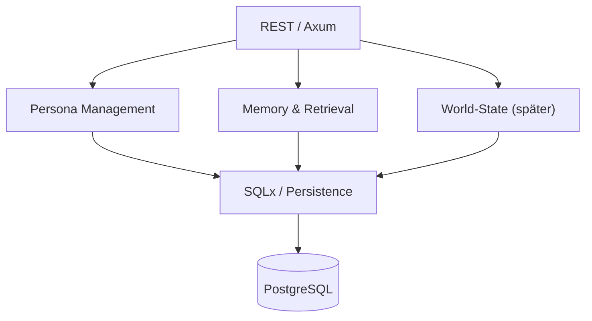

# arc42 – The Sara Protocol

> Status: Implementierungsstand und Zielbild · 30.10.2026 · Dokumentationssprache: Deutsch. Code, API-Bezeichner und Commit-Nachrichten bleiben Englisch.

Diese Übersicht trennt die implementierte lokale Persona-/Memory-API von späteren LLM-, World-State- und Client-Funktionen. Bestehende Architekturentscheidungen werden verlinkt statt dupliziert. Die technische Registry-Nachprüfung nach #50 besteht; Ricos Abnahmefreigabe steht aus.

## 1. Einführung und Ziele

Ein lokal entwickelbarer, portabler Persona-, Memory- und World-State-Dienst für mehrere KI-Charaktere. REST-API zum Persistieren, Abrufen und Suchen. Wichtige Qualitätsziele: Datenisolation, Nachvollziehbarkeit der Erinnerungsquellen, Wartbarkeit und Portabilität.

## 2. Randbedingungen

- Rust, Axum, Tokio, Serde und SQLx
- PostgreSQL mit JSONB, später optional pgvector
- macOS, Docker Compose, IntelliJ IDEA Ultimate
- Dokumentation auf Deutsch, technische Namen auf Englisch
- Entwicklung über Branches, Review und möglichst Squash-Merge

## 3. Kontextabgrenzung

Geplante Clients: ChatGPT, lokale LLMs, IDE und später eine Weboberfläche. Der Dienst stellt eine REST-API bereit; LLM-Integration ist zunächst nachgelagert.

**Systemgrenze:** Die REST-API und ihre Datenhaltung gehören zum Sara Protocol. Clients und externe bzw. lokale LLM-Laufzeiten liegen außerhalb.

## 4. Lösungsstrategie

Local-first und API-first. Personas, Memories und World-State werden getrennt modelliert. Erinnerungen erhalten Provenienz (Quelle, Zeit, bestätigter oder abgeleiteter Status). Administrative Änderungen müssen autorisiert, auditierbar und rücksetzbar sein.

## 5. Bausteinsicht

HTTP-Routing, Persona-/Memory-Endpunkte und SQLx/PostgreSQL-Persistenz sind implementiert. Der World-State-Zweig ist weiterhin Zielarchitektur; Suche und LLM-Adapter fehlen ebenfalls noch.

## 6. Laufzeitsicht

Implementiert sind `GET /health`, `POST /personas`, `GET /personas/{id}` und `POST`/`GET /personas/{id}/memories`. Der Dienst verbindet sich vor Öffnen des HTTP-Ports mit PostgreSQL und führt die versionierten Migrationen aus. Persona- und Memory-Anfragen bleiben nach Persona-ID getrennt; Memories speichern Quelle, Ereigniszeit und Bestätigungsstatus. `GET /openapi.json` liefert den am Code generierten Vertrag. API-Fehler und JSON-Schemas sind getestet. RFC3339-Zeitangaben werden vor dem Schreiben validiert; nicht unterstützte Altwerte erzeugen kontrollierte 500-Antworten (Fix #50 / PR #52). Authentifizierung und Client-Autorisierung bleiben offen.

## 7. Verteilungssicht

Das Rust-Paket liegt unter `backend/`, ohne Cargo-Workspace im Root. Lokal läuft der Prozess aus diesem Verzeichnis. Alternativ baut Compose mit dem Kontext `backend/` ein Backend-Image und startet es nach gesundem PostgreSQL. Das Backend läuft als unprivilegierter Benutzer aus `/app/backend` mit mitgeliefertem `migrations/`; es erreicht PostgreSQL intern unter `postgres:5432`. Host-Ports sind auf Loopback beschränkt. Gemeinsame Konfiguration und Docs bleiben im Root. Für die Abnahme zieht `compose.acceptance.yaml` ein vorgebautes GHCR-Image per Digest ohne lokalen Build. Native Cargo-Jobs für amd64/arm64 kompilieren getrennt vom Runtime-Packaging; beide Images werden nativ gestartet und nach main-QA als Multiarch-Index veröffentlicht. `MIGRATIONS_DIR` im Image ist absolut. Siehe [Entwicklungsanleitung](../getting-started.md), [Release-/Image-Ablauf](../releases.md) und ADR 0005/0007/0008/0009 im [ADR-Verzeichnis](../adr/README.md).

## 8. Querschnittliche Konzepte

- Persona-Isolation und Berechtigungen
- Memory Provenance und Versionierung
- REST, JSON, OpenAPI
- Audit-Log und Rollback administrativer Änderungen
- Tests und Migrationen
- Trennung von fiktionalem Szenenstatus und operativem Systemzustand

## 9. Architekturentscheidungen

Siehe [ADR-Verzeichnis](../adr/README.md), insbesondere Rust/Axum, PostgreSQL/JSONB, Runtime-Migrationen, Backend-Verzeichnis, OpenAPI und native Komponenten-Releases. ADR 0003 bleibt ein historischer Entwurf; die tatsächliche Beitrags-/Trailer-Regel steht in AGENTS.md.

## 10. Qualitätsanforderungen

Nachvollziehbare Datenherkunft, sichere Trennung mehrerer Personas, reproduzierbares lokales Setup und testbare API. Die [technischen Abnahmebelege](../acceptance/2026-10-30-sprint0-retest.md) prüfen Registry-Image, APIs, Provenienz, beidseitige Isolation und Persistenz nach vollständigem Stack-Neustart. Kernfälle und Zeitstempel-Grenzfälle bestehen nach Fix #50. Native Build-/Packaging-Messwerte sind im gemergten PR #49 dokumentiert; daraus wird keine garantierte Laufzeit abgeleitet.

## 11. Risiken und technische Schulden

- LLM-Latenz und Retrieval-Qualität könnten wichtiger sein als die Wahl der Implementierungssprache.
- Authentifizierung, Rechtekonzept, Backup, Embeddings und Datenmodell sind noch offen.
- Die Registry-Image-Nachprüfung nach Fix #50 besteht; die Freigabe durch Rico steht aus. Release-/Versions-PR-Betriebsnachweise #44/#47 stehen ebenfalls noch aus.
- Keine unkontrollierten Persona-Änderungen oder System-Root-Rechte.

## 12. Glossar

- **Persona:** Konfigurierbare fiktionale KI-Figur mit Eigenschaften und Verhalten.
- **Memory:** Persistierte Information mit Herkunft und Status.
- **World-State:** Orte, NPCs und Szenenstatus innerhalb einer fiktionalen Welt.
- **Provenienz:** Herkunft, Zeitpunkt und Bestätigungsgrad einer Erinnerung.
- **ADR:** Architecture Decision Record, dokumentierte Architekturentscheidung.

## Weitere Unterlagen

- [Architekturentwurf](../architecture.md)
- [Roadmap](../roadmap.md)
- [Persona](../persona.md)
- [World-State](../world-state.md)
